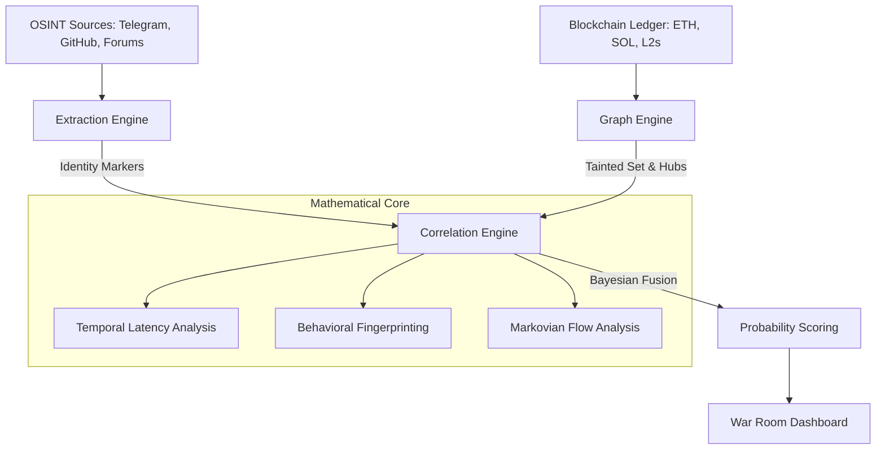

# 🛡️ Quantitative OSINT Blockchain Engine (QOBE)

QOBE is a forensic fusion system designed to deanonymize malicious blockchain actors by mathematically correlating unstructured Open-Source Intelligence (OSINT) with high-velocity ledger data.

## 🚀 Quick Start

### 1. Installation
```bash
pip install -r requirements.txt
npm install
```

### 2. Generate Synthetic Data
```bash
python generate_data.py
```

### 3. Run the Full-Stack System
To run the professional "War Room" interface, you must start the backend server first.

**Terminal 1: Start the Forensic API (The Brain)**
```bash
python backend/main.py
```

**Terminal 2: Start the React Frontend (The Visuals)**
```bash
npm run dev
```

### 4. Alternative: Rapid Prototype View
If you prefer the fast, data-centric Streamlit dashboard:
```bash
streamlit run app.py
```

### 5. Run Evaluation
To verify the engine's accuracy against the ground truth:
```bash
python evaluate.py
```

## 📐 System Architecture



## 🧪 How it Works

1.  **OSINT Extraction**: Uses a hybrid Regex + LLM approach to find wallet addresses, IPs, and handles in messy text.
2.  **Ledger Graphing**: Models the blockchain as a weighted directed graph. It identifies the "Drain Wallet" (source of theft) and "Hubs" (wallets that split funds).
3.  **Temporal Fusion**: Calculates the time-delta between a social media post and a transaction burst. A **Permutation Test** is used to generate a p-value, proving the link isn't a coincidence.
4.  **Behavioral Matching**: Matches "Gas Quirks" (unique gas prices used by bots) between OSINT leaks and on-chain behavior.
5.  **Bayesian Scoring**: Fuses all evidence into a final posterior probability of identity.

## 📊 Expected Results
The engine is designed to discover:
- **100% Recall** on laundering wallets (Hubs and Leaves).
- **High Precision** links between handles (e.g., `@n0x_phantom`) and attacker wallets.
- **Identification** of the hidden Gas Funder seeding the infrastructure.

## ⚖️ Ethics & Limitations
- **Probabilistic, Not Proof**: This tool provides *evidence* for investigators, not legal proof.
- **False Positives**: High-volume wallets or common bot scripts may create noise.
- **Privacy**: Only uses public blockchain data and public OSINT feeds.
