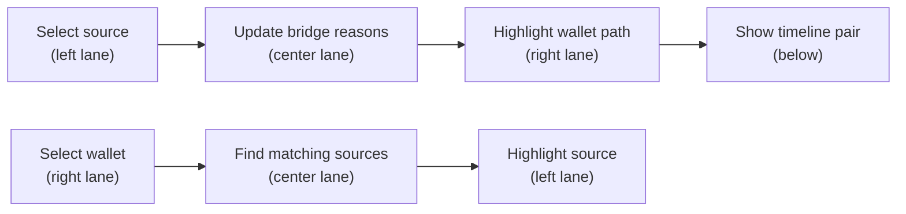

# QOBE Frontend Overhaul: The Evidence Bridge

> **Hard constraints**: Keep every existing element. Keep the amethyst palette, current color saturations, Manrope + JetBrains Mono. No glassmorphism. No gradients except the bridge fusion spine. No neon glow, particle streams, scanlines, or continuous animations.

---

## Direction

Make QOBE feel like a precise forensic instrument built for two disciplines working on the same incident. The default screen puts **OSINT evidence on the left**, **blockchain activity on the right**, and an **inspectable correlation bridge between them**. The impressive moment is seeing a source excerpt illuminate its corresponding transaction path — once, deliberately, after a user action.

Use **Ghost Attacks** as the case/demo title. Use **Evidence Bridge** as the name for the shared workspace where both teams' data converges.

---

## Visual System

Keep the existing amethyst dark theme. Introduce two subtle **domain tints** — warm for OSINT, cool for blockchain — as accent marks only. The canvas, surfaces, borders, and text stay exactly as they are.

### Existing Tokens (Preserved)

| Token | Value | Use |
|-------|-------|-----|
| Canvas | `#191420` | Application background |
| Surface | `#30283d` | Panel backgrounds |
| Surface raised | `#3c314b` | Selected/inspector surfaces |
| Text | `#faf5ff` | Primary text |
| Muted | `#bfb1cf` | Secondary text |
| Accent (Iris) | `#c7a4ff` | Selection, correlation links, active states |
| Border | `#584664` | Panel borders |
| Border-line | `#806497` | Dividers |
| Danger | `#ffa4b9` | Warnings, high-confidence flags |
| Success | `#8be3bd` | Confirmed states, frozen |
| Warning | `#f2c581` | Caution states |

### New Domain Tints (Additive Only)

| Token | Value | Use |
|-------|-------|-----|
| `--osint-mark` | `#D5AD73` (brass) | Left-border on OSINT artifacts, source-type labels, team label |
| `--ledger-mark` | `#78B5D2` (glacier) | Wallet addresses in bridge context, chain labels, team label |

> [!NOTE]
> These two tints appear **only** inside the Evidence Bridge lane headers, source/wallet anchor marks, and the bridge spine. Every other surface, panel, button, and text color stays identical to the current theme.

### Typography (Unchanged)

- **Manrope**: Headings, body, controls, numeric summaries
- **JetBrains Mono**: Wallet strings, code excerpts, transaction hashes, time deltas, extracted markers
- Sizes: 28–30px page titles, 14–15px section titles, 12px body/labels, 11px annotations
- Tabular figures for amounts and changing values

### Spacing & Surfaces (Unchanged)

- 8px rhythm, 24–36px workspace padding, 6px control radii, 10px panel radii
- Most canvas stays unboxed; selected evidence and inspectors get bounded surfaces
- Group rows with spacing and subtle rules — no heavy card borders everywhere

---

## Navigation & Shell Changes

### Sidebar

Keep the current sidebar structure. Rename workspaces to reflect the new framing:

| Current | New | Icon |
|---------|-----|------|
| Case overview | **Evidence Bridge** | `Network` (keep) |
| Forensic matrix | **Ledger** | `Network` → `Activity` |
| OSINT evidence | **Evidence** | `Radar` (keep) |
| Latency model | **Models** | `Activity` (keep) |
| Freeze warrants | **Case** | `FileCheck2` (keep) |

The **Evidence Bridge** becomes the default landing page (hash `#/bridge`). Add a redirect from `#/overview` → `#/bridge` so existing links work.

### Top Bar

- Replace "Case AT-42M-0214" breadcrumb text with **"Ghost Attacks"** as the case title
- Keep the case reference `#AT-42M-0214` visible in the breadcrumb
- Add a small **replay-data indicator** next to the active-case dot: a `JetBrains Mono` label reading `Replay data · 02:14 UTC exploit` — making it clear this is fixture data, not a live feed
- Keep the primary CTA button (freeze/export) exactly as-is

### Bridge Fusion Spine

The one permitted gradient: a thin **3px horizontal line** between the topbar and workspace content. This is the "bridge spine" — a static bar that uses:

```css
background: linear-gradient(90deg, var(--osint-mark), var(--accent), var(--ledger-mark));
```

It sits quietly as a visual anchor. No animation, no pulsing — just a permanent structural cue showing OSINT → fusion → blockchain.

---

## Evidence Bridge — The Signature Screen

This replaces the current Case Overview as the default workspace. **All existing Case Overview elements are preserved** and redistributed into the three-lane layout.

### Desktop Layout (≥1280px)

```
┌─────────────────────────────────────────────────────────────────────┐
│ Evidence Bridge                               #AT-42M-0214         │
│ Synchronized OSINT-to-ledger correlation for Ghost Attacks         │
├─────────────────────────────────────────────────────────────────────┤
│ 42.00M drained · 9 wallet clusters · 5 indexed sources · 06:00    │
├───────────────────┬──────────────────┬──────────────────────────────┤
│                   │                  │                              │
│ OSINT             │ Evidence Bridge  │ Blockchain analysts          │
│ investigators     │                  │                              │
│                   │                  │                              │
│ ┌───────────────┐ │ ┌──────────────┐ │ ┌────────────────────────┐  │
│ │ Source list    │ │ │ Matching     │ │ │ Compact transaction    │  │
│ │               │ │ │ reasons      │ │ │ graph (reused from     │  │
│ │ @kestrel_0x   │ │ │              │ │ │ MatrixGraphCanvas)     │  │
│ │ GitHub commit │─┼─│ Fee match    │─┼─│                        │  │
│ │               │ │ │ 3.14159 gwei │ │ │ Selected path          │  │
│ │ @v0id_dev     │ │ │              │ │ │ highlighted            │  │
│ │ Telegram post │ │ │ Timing match │ │ │                        │  │
│ │               │ │ │ +1.40s       │ │ │ Wallet inspector       │  │
│ │ @lynx_crypt   │ │ │              │ │ │ below graph            │  │
│ │ Dark web post │ │ │ Candidate    │ │ │                        │  │
│ └───────────────┘ │ │ link score   │ │ └────────────────────────┘  │
│                   │ └──────────────┘ │                              │
├───────────────────┴──────────────────┴──────────────────────────────┤
│ Synchronized timeline: OSINT events + ledger transactions on UTC   │
└─────────────────────────────────────────────────────────────────────┘
```

**Column widths**: ~28% OSINT, ~20% bridge, ~52% blockchain.

### Where Current Overview Elements Go

| Current Element | New Location |
|----------------|--------------|
| Incident notice (DeFi exploit, Tuesday 02:14 UTC) | **Compact stat bar** at top of Bridge page — single row with key metrics |
| Metric strip (4 cards: $42M, actor, Δt, frozen) | **Collapsed into stat bar** — horizontal inline metrics, not large cards |
| Attribution panel (identity-to-wallet list) | **Left lane** — becomes the OSINT source list with suspect correlation |
| Investigation brief | **Removed as standalone panel** — its content merges into the Bridge page header and the case/about section |
| Workspace shortcuts (3 links) | **Kept at bottom** of Bridge page, restyled as a simple row |

> [!IMPORTANT]
> Nothing is deleted. The incident notice becomes the stat bar. The metric values become inline stats. The attribution rows become the source list items. The brief content becomes header text. The shortcuts stay.

### Left Lane: OSINT Investigators

Header: **"OSINT investigators"** in `--osint-mark` color, with a small brass left-border.

Content: the existing `correlations` array, but each row is presented as a **source card** showing:
- Suspect handle (from `suspectHandle`) — `JetBrains Mono`
- Real name hint (from `realNameHint`)
- Source type badge: the `sourceType` from their linked artifacts
- Extracted markers: IPs, wallet fragments, gas quirk — displayed as small inline tags
- Left border colored `--osint-mark`

Clicking a source card = selecting that suspect. This drives the bridge and right lane.

### Center Lane: Evidence Bridge

Header: **"Evidence Bridge"** in `--accent` (iris) color.

Shows the **matching reasons** between the selected OSINT source and the blockchain wallet it correlates to:

- **Fee match**: if the suspect's artifact has `extractedGasQuirk` matching a node's `gasFingerprintGwei`
- **Wallet reference**: if `extractedWallets` in the artifact overlap with node addresses
- **Timing association**: `meanTimeDeltaSec` with the specific OSINT event timestamp vs. closest ledger tx
- **Graph proximity**: `graphClusterScore` expressed as cluster affinity

Each reason is a small card with:
- Reason label
- Observed value (e.g., `3.14159 gwei`)
- Source reference → linked artifact ID
- Solid connecting lines (left) and dashed lines (right) using SVG or CSS borders

At the bottom: the **correlation score** — the `posteriorProbability` displayed as "Model score: XX.X%" with the status label underneath. No danger color for high scores — it's a score, not a threat level.

Below the reasons: a "bridge spine" line — the one gradient element — connecting the left and right lanes visually.

### Right Lane: Blockchain Analysts

Header: **"Blockchain analysts"** in `--ledger-mark` color, with a glacier left-border.

Content: a **compact version of MatrixGraphCanvas** showing the transaction graph with:
- The selected suspect's target wallet cluster highlighted (border color `--accent`)
- Connected transaction paths emphasized, other paths dimmed but visible
- Below the graph: the existing **wallet inspector** data (chain, address, inflow, outflow, entropy, gas signature, jitter)

This reuses the existing `MatrixGraphCanvas` component in a compact mode (smaller viewBox, no column stage labels, nodes still interactive).

### Stat Bar (Replaces Metric Strip)

A single horizontal row at the top of the Bridge page:

```
$42.00M drained  ·  9 wallet clusters  ·  5 indexed sources  ·  @kestrel_0x 96.4%  ·  $1.12M frozen
```

All values from the existing metric strip — just inline instead of 4 large cards. Monospace for numbers. Separator dots between values. No colored backgrounds — just text.

### Synchronized Timeline (Below Bridge)

A horizontal row showing OSINT events and ledger transactions on the same time axis. This data already exists:
- OSINT events: `artifacts[].timestampSec` — shown above the axis with brass marks
- Ledger transactions: `edges[].timestampSec` — shown below the axis with glacier marks
- Selected correlation pair highlighted

This is the existing "Synchronized OSINT-to-Blockchain Timestamp Alignment" table from `LatencyAnalysisView`, but rendered as a compact visual timeline rather than a table. The table version stays in the Models screen.

---

## Supporting Screens

### Evidence Screen (Currently OSINT Evidence)

Keep `OsintScraperPanel` exactly as-is with these styling adjustments:

- Section heading uses `--osint-mark` brass left-border to identify the OSINT domain
- Artifact cards: the existing `border-left` (source-colored) stays; no glow, no scanlines
- Extracted markers (IPs, wallets): render as **small tag pills** — `background: var(--surface-raised)`, `border-radius: 4px`, `padding: 2px 8px` — instead of plain text. This makes them visually scannable without being flashy
- The scrape/ingest buttons, search bar, filters, extraction preview, validation — all unchanged
- "Extract & fuse into matrix" button stays `button-primary`

### Ledger Screen (Currently Forensic Matrix)

Keep `MatrixGraphCanvas` exactly as-is with these adjustments:

- Section heading uses `--ledger-mark` glacier left-border to identify the blockchain domain
- **Selected node**: a single subtle pulse on selection (one 300ms `box-shadow` transition, then static) — this is the only animation in the entire app besides page transitions
- **Frozen nodes**: keep the existing red `[FROZEN]` label and danger border — no ice cracks or overlays
- Graph, matrix tables, wallet inspector, cluster selector, stream list — all unchanged
- **Matrix table crosshair**: on hover, highlight the row AND column with `background: var(--surface-raised)` — helps read the 9×9 matrix

### Models Screen (Currently Latency Model)

Keep `LatencyAnalysisView` exactly as-is with these adjustments:

- **Slider tracks**: style with CSS to replace native appearance:
  - Track: `background: var(--border)` (no gradient)
  - Filled portion: `background: var(--accent)` 
  - Thumb: circular, `background: var(--accent)`, `border: 2px solid var(--surface)`
- **Attribution table**: keep all columns. The `posteriorProbability` column label changes from "Posterior P(I|W)" to **"Model score"** — it's the same value, just honest labeling
- **Latency kernel SVG**: keep the curve, grid lines, and observed marker exactly as-is
- **Timestamp alignment table**: add `--osint-mark` brass tint on the OSINT event column header, `--ledger-mark` glacier tint on the ledger tx column header — subtle domain identification

### Case Screen (Currently Freeze Warrants)

Keep `FreezeWarrantsView` exactly as-is with these adjustments:

- Rename section titles: "Offshore exchange interception" → **"Intervention records"**
- The warrant table, endpoint list, and affidavit — all stay
- Freeze buttons: keep exact behavior. Add a label clarifying this is a **simulated workflow** — small muted text: "Demo: simulated freeze action"
- Move the **workspace shortcuts** (3 links from the current overview bottom) here as "Quick navigation" at the bottom of the Case screen
- The JSON export button and functionality stay

---

## Interaction Model

### Selection Flow (Bridge Screen)



- Clicking a source card selects it → bridge reasons populate → wallet path highlights → timeline pair highlights
- Clicking a wallet node reverses: surfaces related source artifacts. If none match, show an explicit empty state: "No indexed off-chain evidence for this cluster"
- Clicking a bridge reason opens the detail: artifact ID, transaction IDs, observed value, method

### State Management

Use the existing top-level state in `App.tsx`. Add:

```typescript
// New state alongside existing selectedNodeId, selectedSuspectId
const [selectedArtifactId, setSelectedArtifactId] = useState<string | null>(null);
const [selectedCorrelationId, setSelectedCorrelationId] = useState<string | null>(null);
```

Derive bridge reasons from the existing `correlateIdentities` output — no new engine logic needed for pass 1. The existing `correlations` array already contains `targetWalletId`, `suspectHandle`, `meanTimeDeltaSec`, `temporalScore`, `behavioralScore`, `graphClusterScore`, and `posteriorProbability`.

---

## Motion & Restraint

| What | How | Duration |
|------|-----|----------|
| Page/workspace transitions | `opacity` + `translateY(4px)` CSS transition | 150ms |
| Source-to-wallet connection reveal | Bridge reasons fade in, wallet path border transitions to `--accent` | 300ms total |
| Node selection | `box-shadow` transition from `none` to `0 0 0 2px var(--accent)` | 200ms |
| Button hover | `background-color` transition | 150ms (existing) |
| Status banner | `opacity` + `translateY(-8px)` transition on mount | 200ms |

**Nothing else animates.** No continuous pulsing, no particle streams, no gradient shifts, no spinning icons. The graph is still during reading. Positions are stable across updates.

> [!TIP]
> All transitions respect `@media (prefers-reduced-motion: reduce)` — transitions drop to 0ms.

---

## Responsive Behavior

| Breakpoint | Layout |
|------------|--------|
| ≥1280px | Full three-lane bridge layout. ~28/20/52 split |
| 900–1279px | Bridge narrows to a compact explanation rail between source and ledger. Source list and graph stay side-by-side. Detailed bridge content opens in a slide-out panel |
| ≤900px | Stack: Source list → Bridge reasons → Ledger graph. Each section full-width. Concise team labels stay visible |
| ≤600px | Single column. Graph gets horizontal scroll at `min-width: 850px` (existing). Source list becomes compact cards |

All existing responsive breakpoints in `index.css` are preserved and adapted.

---

## Files to Modify

| File | Scope | Changes |
|------|-------|---------|
| [`index.css`](file:///c:/Users/kabir/Downloads/HackForge/src/index.css) | Heavy | Add `--osint-mark`, `--ledger-mark` tokens. Add bridge spine bar styles. Add three-lane grid. Add stat bar styles. Add tag pill styles. Add custom slider appearance. Add matrix crosshair. Add domain-tint header styles. Update workspace accent colors for renamed sections. Adjust responsive grid for bridge layout |
| [`App.tsx`](file:///c:/Users/kabir/Downloads/HackForge/src/App.tsx) | Moderate | Rename workspaces. Add `selectedArtifactId`/`selectedCorrelationId` state. Add bridge spine `div`. Update default hash to `#/bridge`. Add redirect from `#/overview`. Add replay-data label in topbar. Pass new selection props to Bridge component |
| [`CaseOverview.tsx`](file:///c:/Users/kabir/Downloads/HackForge/src/components/CaseOverview.tsx) | Heavy → becomes **`BridgeWorkspace.tsx`** | Restructure into three-lane layout. Move metric strip values into inline stat bar. Move attribution rows into OSINT source list. Add bridge reasons center column. Embed compact `MatrixGraphCanvas` in right lane. Add synchronized timeline below. Keep all data/props |
| [`MatrixGraphCanvas.tsx`](file:///c:/Users/kabir/Downloads/HackForge/src/components/MatrixGraphCanvas.tsx) | Light | Add optional `compact` prop for bridge embedding. Add `crosshair` hover class. Add `--ledger-mark` header tint. Keep all existing functionality |
| [`OsintScraperPanel.tsx`](file:///c:/Users/kabir/Downloads/HackForge/src/components/OsintScraperPanel.tsx) | Light | Add `--osint-mark` header tint. Add tag pill classes for extracted markers. Keep everything else |
| [`LatencyAnalysisView.tsx`](file:///c:/Users/kabir/Downloads/HackForge/src/components/LatencyAnalysisView.tsx) | Light | Custom slider styling (CSS only). Rename "Posterior P(I\|W)" label to "Model score". Add domain-tint column headers. Keep everything else |
| [`FreezeWarrantsView.tsx`](file:///c:/Users/kabir/Downloads/HackForge/src/components/FreezeWarrantsView.tsx) | Light | Rename section title. Add "simulated workflow" label. Move workspace shortcuts here. Keep everything else |
| [`main.tsx`](file:///c:/Users/kabir/Downloads/HackForge/src/main.tsx) | Minimal | No font changes needed (Manrope + JetBrains Mono stay) |
| [`index.html`](file:///c:/Users/kabir/Downloads/HackForge/index.html) | None | Already has good meta tags |

---

## Implementation Order

### Pass 1: Foundation & Shell
- Add `--osint-mark` and `--ledger-mark` CSS tokens
- Add bridge spine bar (3px gradient below topbar)
- Rename workspaces in sidebar
- Add replay-data label in topbar
- Update hash routing (`#/bridge` default, `#/overview` redirect)
- Add `selectedArtifactId` and `selectedCorrelationId` to `App.tsx` state
- Custom slider appearance in CSS

### Pass 2: Build the Evidence Bridge
- Create `BridgeWorkspace.tsx` (or refactor `CaseOverview.tsx`)
- Build three-lane grid layout
- Move metric strip → inline stat bar
- Move attribution rows → OSINT source list (left lane)
- Build bridge reasons column (center lane)
- Embed compact `MatrixGraphCanvas` (right lane)
- Build synchronized timeline row (bottom)
- Wire selection: source click → bridge → wallet highlight

### Pass 3: Refine Supporting Screens
- Add domain-tint headers to Evidence, Ledger, Models screens
- Tag pill styling for extracted markers in OSINT panel
- Matrix crosshair hover on Ledger screen
- Rename labels on Models and Case screens
- Move workspace shortcuts to Case screen
- Add "simulated workflow" labels

### Pass 4: Responsive & Polish
- Three-lane → two-lane → stacked responsive breakpoints
- Keyboard accessibility for new bridge interactions
- Empty/no-match states for bridge
- `prefers-reduced-motion` for all transitions
- TypeScript check + production build verification

---

## What Stays Untouched

- ✅ All engine logic in [`forensicEngine.ts`](file:///c:/Users/kabir/Downloads/HackForge/src/engine/forensicEngine.ts) and [`forensicEngine.test.ts`](file:///c:/Users/kabir/Downloads/HackForge/src/engine/forensicEngine.test.ts)
- ✅ All component props, interfaces, and data flow
- ✅ Canvas/surface/border/text colors and saturations
- ✅ Manrope + JetBrains Mono fonts
- ✅ All functional behavior: scraping, freezing, exporting, filtering, searching, model tuning
- ✅ All accessibility: aria labels, keyboard nav, focus management, skip link, screen reader support
- ✅ Mobile navigation drawer and responsive logic
- ✅ Backend/API layer and Python implementation
- ✅ Test infrastructure
